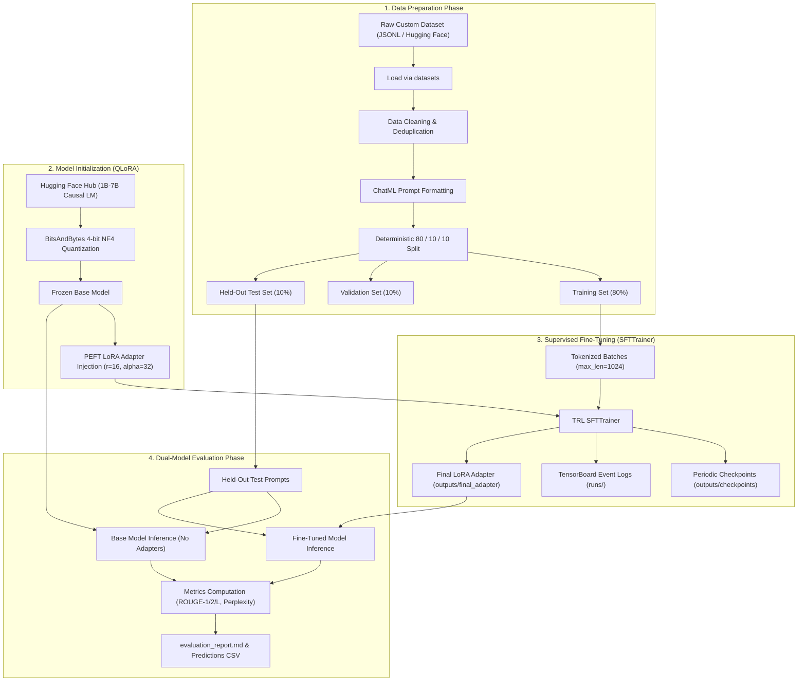

# LLM Fine-Tuning Pipeline with LoRA and Hugging Face

[](https://www.python.org/downloads/)
[](https://github.com/huggingface/peft)
[](https://github.com/huggingface/trl)
[](https://www.docker.com/)
[](https://opensource.org/licenses/MIT)

An enterprise-grade, end-to-end Machine Learning pipeline for fine-tuning open-source Large Language Models (1B–7B parameters, e.g., `Qwen/Qwen2.5-1.5B-Instruct`, `microsoft/Phi-3-mini-4k-instruct`, `mistralai/Mistral-7B-v0.1`) using Parameter-Efficient Fine-Tuning (PEFT) with 4-bit Quantized Low-Rank Adaptation (QLoRA), tracked via TensorBoard, containerized via Docker, and systematically evaluated on held-out test splits.

---

## 📑 Table of Contents
- [Architecture Overview](#architecture-overview)
- [Repository Structure](#repository-structure)
- [Hardware & Environment Specifications](#hardware--environment-specifications)
- [Quickstart & Local Installation](#quickstart--local-installation)
- [Step-by-Step Execution Workflow](#step-by-step-execution-workflow)
  - [1. Data Acquisition and Preprocessing](#1-data-acquisition-and-preprocessing)
  - [2. Model Configuration & LoRA Injection](#2-model-configuration--lora-injection)
  - [3. Training Loop with SFTTrainer & TensorBoard](#3-training-loop-with-sfttrainer--tensorboard)
  - [4. Dual-Model Evaluation on Held-Out Test Set](#4-dual-model-evaluation-on-held-out-test-set)
  - [5. Standalone Inference & Adapter Merging](#5-standalone-inference--adapter-merging)
- [Docker Containerization](#docker-containerization)
- [Automated Testing](#automated-testing)
- [Hyperparameter Configuration](#hyperparameter-configuration)
- [Troubleshooting & FAQ](#troubleshooting--faq)

---

## 🏛 Architecture Overview

The pipeline strictly isolates the data preparation, quantized model initialization, training with MLOps tracking, and independent dual-model evaluation:



---

## 📂 Repository Structure

The project strictly follows the standard MLOps machine learning project structure:

```
llm-finetuning-pipeline/
├── .venv/                              # Local Python virtual environment
├── .env                                # Local secrets and environment variables
├── .env.example                        # Safe template; no real secrets
├── .gitignore                          # Excludes caches, large weights, virtual envs
├── .dockerignore                       # Excludes unnecessary build files
├── README.md                           # Comprehensive documentation & reproduction guide
├── requirements.txt                    # Pinned, compatible dependencies
├── pyproject.toml                      # Tooling & pytest configuration
├── Dockerfile                          # Reproducible NVIDIA PyTorch CUDA environment
├── docker-compose.yml                  # Container GPU reservation & volume mapping
├── Makefile                            # Convenient workflow shortcuts
├── configs/
│   ├── training_config.yaml            # Model, LoRA, and training hyperparameters
│   └── evaluation_config.yaml          # Evaluation and generation settings
├── data/
│   ├── raw/
│   │   └── .gitkeep                    # Original raw dataset cache
│   ├── processed/
│   │   ├── train.jsonl                 # 80% training examples
│   │   ├── validation.jsonl            # 10% validation examples
│   │   └── test.jsonl                  # 10% held-out test examples (zero leakage)
│   └── samples/
│       └── sample_100.jsonl            # Representative 100-sample preview
├── src/
│   ├── __init__.py
│   ├── data_pipeline.py                # Acquisition, cleaning, ChatML formatting, splitting
│   ├── model_utils.py                  # AutoModel, 4-bit NF4 BitsAndBytesConfig, LoRA setup
│   ├── train.py                        # SFTTrainer training loop with TensorBoard tracking
│   ├── evaluate.py                     # Dual-model evaluation & ROUGE/perplexity reporting
│   ├── inference.py                    # Standalone/interactive inference with adapter
│   ├── merge_adapter.py                # Optional utility to merge adapter into base weights
│   └── utils/
│       ├── __init__.py
│       ├── config.py                   # YAML parsing, validation, and CLI overrides
│       ├── logging_utils.py            # Structured console and file logging
│       ├── metrics.py                  # ROUGE-1/2/L and perplexity calculators
│       └── reproducibility.py          # Deterministic seed setting & hardware inspection
├── tests/
│   ├── __init__.py
│   ├── test_data_pipeline.py           # Dataset formatting, splits, deduplication tests
│   ├── test_config.py                  # YAML loading and schema validation tests
│   ├── test_model_setup.py             # LoRA injection and parameter counting tests
│   └── test_metrics.py                 # ROUGE and perplexity unit tests
├── outputs/
│   ├── checkpoints/                    # Intermediate training checkpoints
│   ├── final_adapter/                  # Saved LoRA adapter (safetensors + config)
│   └── predictions/                    # Comparative test predictions and metrics JSON
├── runs/                               # TensorBoard event logs
├── reports/
│   └── figures/                        # Metric plots and loss curves
├── notebooks/
│   └── exploration.ipynb               # Exploratory data analysis notebook
└── evaluation_report.md                # Final analytical report comparing Base vs Tuned
```

---

## 💻 Hardware & Environment Specifications

- **Local Development (CPU / Laptop)**:
  - Supports data pipeline processing, unit tests, configuration validation, prompt formatting, and lightweight testing.
  - BitsAndBytes 4-bit CUDA quantization gracefully alerts user and falls back to CPU float32 for testing if CUDA is unavailable.
- **GPU Training Runtime (NVIDIA GPU with CUDA 12.1+)**:
  - Required for executing 4-bit NormalFloat QLoRA training and full batched model evaluation.
  - Minimum VRAM required for 1.5B model: ~6GB VRAM.
  - Minimum VRAM required for 7B model: ~14GB VRAM (single RTX 3090/4090 or T4/A10G).

---

## 🚀 Quickstart & Local Installation

### 1. Clone & Set Up Virtual Environment

```bash
git clone https://github.com/rakeshchinni77/llm-finetuning-pipeline.git
cd llm-finetuning-pipeline

# Create virtual environment
python -m venv .venv

# Activate virtual environment
# On Linux/macOS:
source .venv/bin/activate
# On Windows PowerShell:
.\.venv\Scripts\Activate.ps1
```

### 2. Install Dependencies

```bash
pip install --upgrade pip
pip install -r requirements.txt
```

### 3. Configure Secrets

Copy `.env.example` to `.env` and provide your Hugging Face token:
```bash
cp .env.example .env
```

---

## 🛠 Step-by-Step Execution Workflow

### 1. Data Acquisition and Preprocessing
Processes raw instructions, cleans duplicates, applies ChatML templates, validates tokenization lengths, and saves non-overlapping 80/10/10 splits:

```bash
python src/data_pipeline.py --config configs/training_config.yaml
```
Output files created:
- `data/processed/train.jsonl` (80%)
- `data/processed/validation.jsonl` (10%)
- `data/processed/test.jsonl` (10% strictly held out)
- `data/samples/sample_100.jsonl`

### 2. Model Configuration & LoRA Injection
Model configuration in `src/model_utils.py` loads the 1B–7B base causal language model (e.g. `Qwen/Qwen2.5-1.5B-Instruct`), initializes 4-bit NormalFloat (NF4) quantization with double quantization, and attaches LoRA adapters to attention and MLP projection layers (`q_proj`, `k_proj`, `v_proj`, `o_proj`, `gate_proj`, `up_proj`, `down_proj`).

### 3. Training Loop with SFTTrainer & TensorBoard
Launch fine-tuning using `src/train.py`. Hyperparameters can be configured via `configs/training_config.yaml` or CLI flags:

```bash
# Standard training run
python src/train.py --config configs/training_config.yaml

# Override hyperparameters via CLI
python src/train.py \
    --learning_rate 2e-4 \
    --per_device_train_batch_size 2 \
    --gradient_accumulation_steps 4 \
    --num_train_epochs 3 \
    --lora_r 16 \
    --lora_alpha 32 \
    --output_dir outputs/checkpoints \
    --final_adapter_dir outputs/final_adapter
```

#### Launch TensorBoard for MLOps Tracking:
```bash
tensorboard --logdir runs --port 6006
```
Navigate to `http://localhost:6006` to observe real-time loss curves, learning rate scheduling, and validation steps.

### 4. Dual-Model Evaluation on Held-Out Test Set
Compares the base model against the fine-tuned PEFT model on the held-out test split, computing ROUGE-1, ROUGE-2, ROUGE-L, and Perplexity:

```bash
python src/evaluate.py --config configs/evaluation_config.yaml
```
Output artifacts:
- `outputs/predictions/evaluation_metrics.json`: Machine-readable quantitative comparison.
- `outputs/predictions/comparison_results.csv`: Side-by-side prompt, ground truth, base response, and tuned response.

### 5. Standalone Inference & Adapter Merging

#### Run Inference with Trained Adapter:
```bash
# Single prompt
python src/inference.py --prompt "Explain the difference between LoRA and QLoRA."

# Interactive session
python src/inference.py --interactive
```

#### (Optional) Merge Adapter into Base Weights:
```bash
python src/merge_adapter.py \
    --base_model_id Qwen/Qwen2.5-1.5B-Instruct \
    --adapter_dir outputs/final_adapter \
    --output_dir outputs/merged_model
```

---

## 🐳 Docker Containerization

To run the pipeline inside a fully reproducible, CUDA-enabled Docker container:

```bash
# Build the container image
docker compose build

# Launch the container with GPU passthrough
docker compose up -d

# Enter container bash shell
docker compose exec llm_tuner bash

# Run complete pipeline inside container
python src/data_pipeline.py
python src/train.py
python src/evaluate.py
```

---

## 🧪 Automated Testing

Run the full pytest suite:

```bash
pytest tests/ -v
```

Tests cover:
- **`test_data_pipeline.py`**: ChatML format compliance, deduplication, dataset size ($\ge 1,000$), zero split leakage.
- **`test_config.py`**: YAML schema validation, split ratio checks, CLI override merging.
- **`test_model_setup.py`**: BitsAndBytesConfig validity, LoRA adapter attachment, trainable parameter calculation.
- **`test_metrics.py`**: ROUGE calculation accuracy and causal perplexity computation.

---

## ⚙️ Hyperparameter Configuration

All parameters are specified in `configs/training_config.yaml`:

| Hyperparameter | Value | Description |
|---|---|---|
| `model_id` | `Qwen/Qwen2.5-1.5B-Instruct` | Base model (1B–7B range) |
| `load_in_4bit` | `true` | QLoRA 4-bit precision |
| `bnb_4bit_quant_type` | `nf4` | NormalFloat4 data type |
| `bnb_4bit_use_double_quant` | `true` | Nested quantization to minimize memory footprint |
| `r` (Rank) | `16` | LoRA bottleneck rank |
| `lora_alpha` | `32` | Scaling factor ($\alpha / r = 2.0$) |
| `target_modules` | `[q_proj, k_proj, v_proj, o_proj, gate_proj, up_proj, down_proj]` | Transformer modules adapted |
| `learning_rate` | `2.0e-4` | Cosine decay schedule with warmup |
| `per_device_train_batch_size` | `2` | Micro-batch size to prevent OOM |
| `gradient_accumulation_steps` | `4` | Effective global batch size of 8 |
| `max_seq_length` | `1024` | Strict sequence truncation limit |
| `report_to` | `tensorboard` | Experiment logging backend |

---

## ❓ Troubleshooting & FAQ

### Q1: How do I avoid CUDA Out of Memory (OOM) errors?
- Set `per_device_train_batch_size: 1` and increase `gradient_accumulation_steps` (e.g. 8).
- Ensure `gradient_checkpointing: true` is enabled.
- Verify `load_in_4bit: true` and `max_seq_length: 1024` are configured.

### Q2: Why is the model repeating phrases endlessly during inference?
- Ensure the tokenizer's `eos_token` is properly configured.
- Specify `eos_token_id=tokenizer.eos_token_id` in generation calls.
- Apply `repetition_penalty: 1.1` in generation configs.

### Q3: Why does training loss drop to zero immediately?
- Check that target responses are not present in the input prompt without proper label masking. Our `src/data_pipeline.py` cleanly separates the input prompt from the response to prevent prompt label leakage.

---

## 📜 License
This project is licensed under the MIT License.
